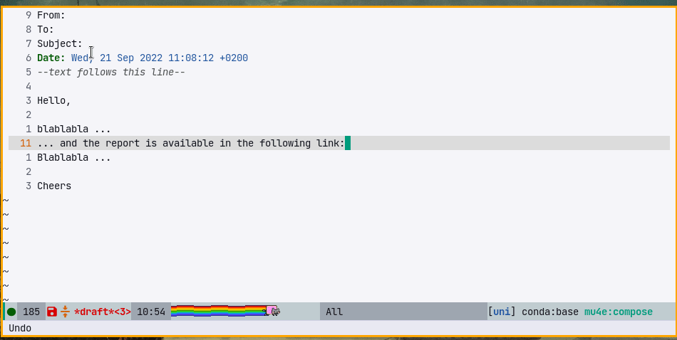

* message-links.el

Emacs library to add reference links in message-mode without html.

** Table of Contents

- [[#what-it-does][What it does]]
- [[#how-to-use][How to use]]
- [[#commands][Commands]]
- [[#customization][Customization]]
- [[#faq][FAQ]]

** What it does

Consider the following textual message with a long link:

#+BEGIN_SRC text
  Hello,

  blablabla ...
  ... and the report is available in the following link: https://my-file-server.org/Y5yu9Z1+3K83NFyPRy0siDw583mc+4iEljFmkUdgIIJuE5OAZTyhV00rXSMu/LP6z/o8HoD8hnXVIg2bwkddXw==
  Blablabla ...

  Cheers
#+END_SRC

This could be transformed into:

#+BEGIN_SRC text
  Hello,

  blablabla ...
  ... and the report is available in the link [1]
  Blablabla ...

  Cheers

  --- links ---
  [1]: https://my-file-server.org/Y5yu9Z1+3K83NFyPRy0siDw583mc+4iEljFmkUdgIIJuE5OAZTyhV00rXSMu/LP6z/o8HoD8hnXVIg2bwkddXw==
#+END_SRC

This mode allows the generation of references in the text as follows:

** How to use

Download this repository into =~/.emacs.d=:

#+BEGIN_SRC emacs-lisp
  (load "~/.emacs.d/message-links.el/message-links.el")
  (define-key message-mode-map (kbd "C-c l") 'message-links-add)
#+END_SRC

Then press =C-c l= when composing a message to add a link.

** Commands

- =message-links-add-link= ::
  Enter a new link.

- =message-links-convert-link-at-point= ::
  Match a link at the cursor location, and convert it to a referenced link
  (uses =message-links-match-link-at-point-functions= to identify links).

- =message-links-convert-links-all= ::
  Convert all links to references in the buffer or active region
  (uses =message-links-match-link-forward-fn= to scan for links).

- =message-links-renumber-all= ::
  Re-number all links starting from =message-links-index-start=,
  putting the footnotes in order if necessary.
  Useful when editing paragraphs that contain links which may become un-ordered.

** Customization

- =message-links-link-header=: Default =--- links ---= ::
  Header used to separate links from the original text. If set to =nil=, disables the header.

- =message-links-index-start=: Default =1= ::
  Start index of links. So by default the first link will be =[1]=.

- =message-links-sep-footnotes-link=: Default =("[" . "]: ")= ::
  The text to use for links in the bottom of the buffer. Default, links look like =[1]: link text=.

  Customize with =(setq message-links-sep-footnotes-link '("{^" . "}: "))=
  and links in footnote will look like ={^1}: link text=

- =message-links-sep-text-link=: Default =("[" . "]")= ::
  The text to use for links in the text. Default, links look like =blablabla [1] blablabla=.

  Customize with =(setq message-links-sep-text-link '("{^" . "}"))= and links in text
  will look like =blablabla {^1} blablabla=.

- =message-links-match-link-at-point-functions= ::
  List of functions to match a link at point.
  Each function is called with no arguments until one returns non-nil (a cons cell of bounds).

  Defaults to:
  - =message-links-match-link-at-point-url= :: Match URLs using =thing-at-point=.
  - =message-links-match-link-at-point-sha1= :: Match Git SHA1 hashes (hexadecimal strings).

- =message-links-match-sha1-min-length=: Default =8= ::
  Minimum length for SHA1 hash matching.

- =message-links-match-link-forward-fn=: Default =message-links-match-link-forward-default= ::
  Takes a single limit argument (representing a buffer position not to seek past),
  returns the bounds of the next link or nil when none are found.

  The default callback steps over white-space for the next =message-links-match-link-at-point-functions=.

- =message-links-limit-range-fn=: Defaults to returning =((point-min) . (point-max))= ::
  Use this to limit the range used for scanning and link insertion.

  Useful when writing commit messages which often show commented status text at the buffer end.
  Often it's preferable to add the links before these comments. For example, see ([[#faq][FAQ]]).

** FAQ

*** I don't want to put the links at the bottom of the buffer

If you work in a Git/SVN commit message or a message with replies,
you want your links at the bottom of your message and not the bottom of the buffer.
Use =message-links-limit-range-fn= for this purpose.

By default, the links appear after the quoted reply:

#+BEGIN_SRC text
  Hello,

  Blabla [1], babla [2].

  > On Thu, 1 Sep 2022, Toto wrote:
  > blablabla
  > bla

  --- links ---
  [1]: foo.org
  [2]: bar.org
#+END_SRC

In fact, you want to add links just before the reply by tweaking =message-links-limit-range-fn=:

#+BEGIN_SRC emacs-lisp
  (setq message-links-limit-range-fn
        (lambda ()
          (let ((min (point-min))
                (max (point-max)))
            (save-excursion
              (goto-char min)
              (forward-line 1)
              (setq min (point))
              (when (re-search-forward
                     (concat "^>")
                     nil t)
                (setq max (line-beginning-position))))
            (cons min max))))
#+END_SRC

#+BEGIN_SRC text
  Hello,

  Blabla [1], babla [2].

  --- links ---
  [1]: foo.org
  [2]: bar.org

  > On Thu, 1 Sep 2022, Toto wrote:
  > blablabla
  > bla
#+END_SRC
